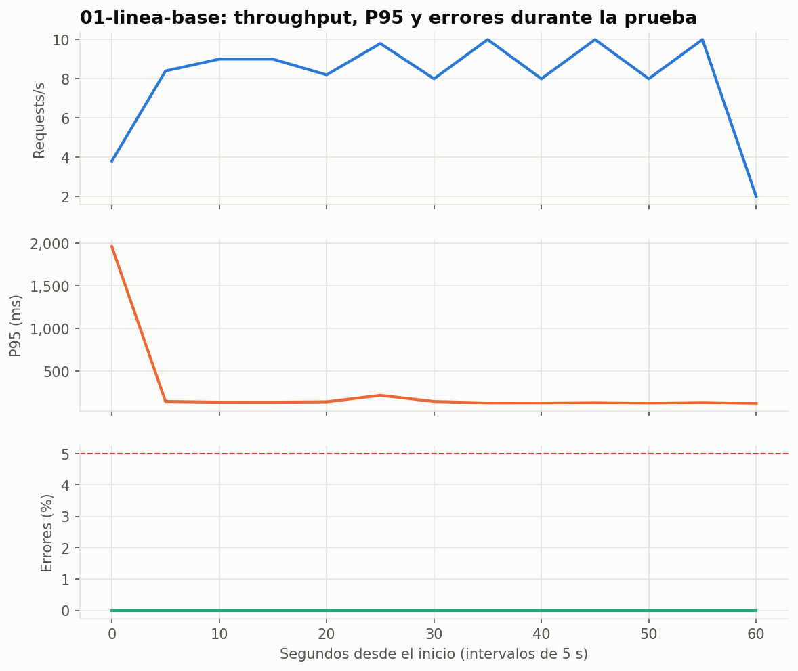
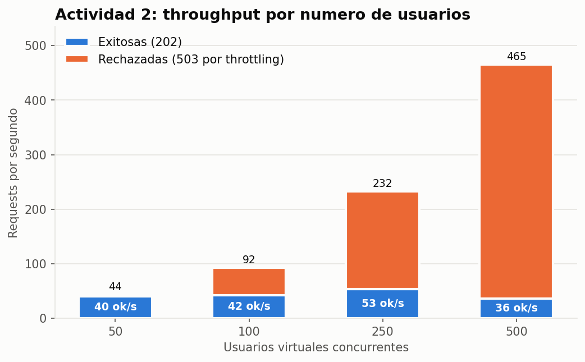
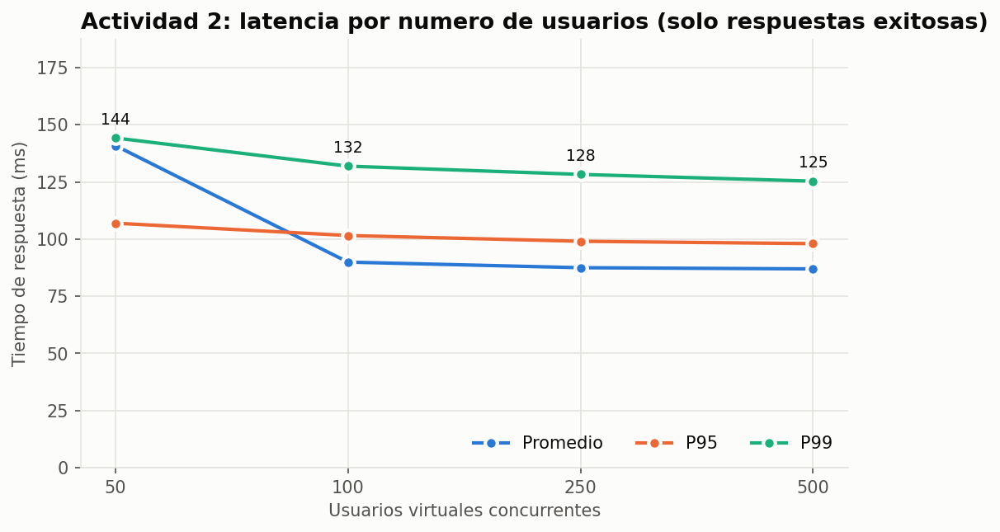
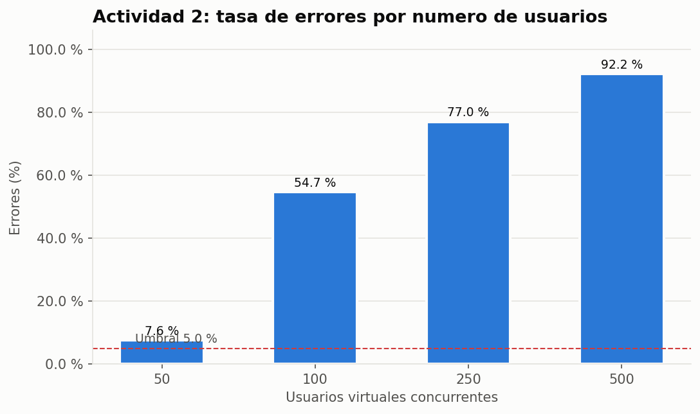
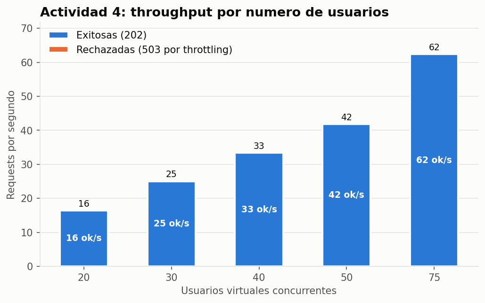
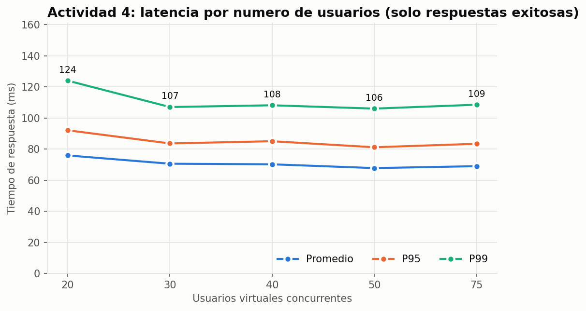
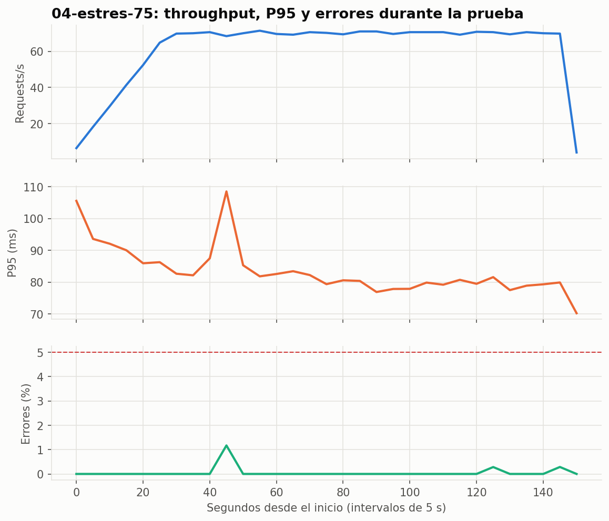
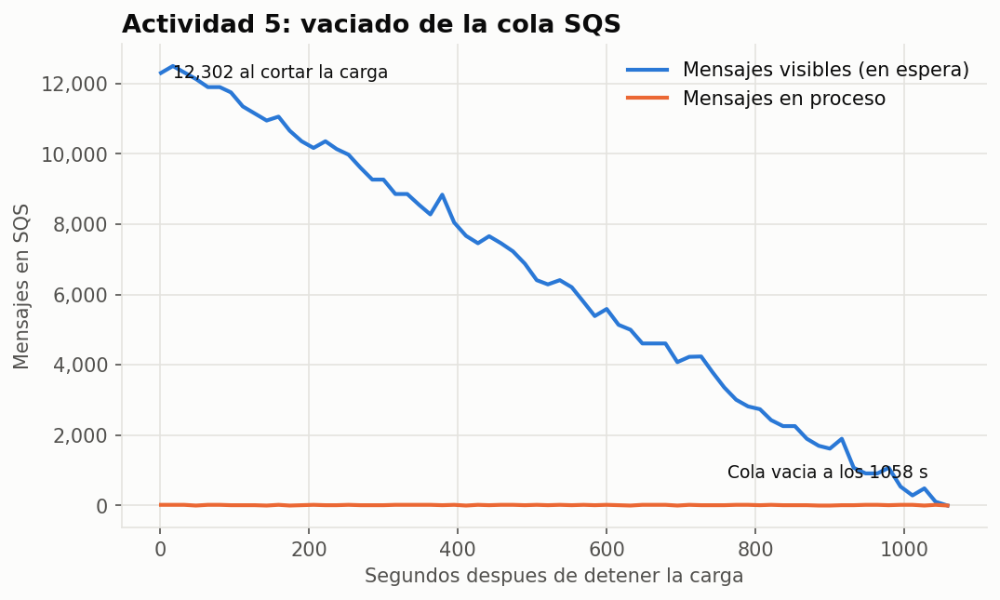
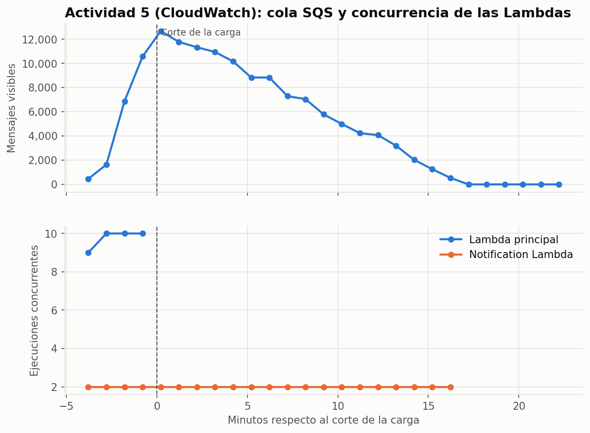

# Informe técnico: pruebas de carga y análisis de rendimiento

**Arquitectura Serverless en AWS (API Gateway → Lambda → SNS → SQS → Notification Lambda)**

Fecha de ejecución: 18 de octubre de 2026 · Región: `us-east-1` · Herramienta: k6 v2.3.0

---

## Resumen ejecutivo

| Pregunta | Respuesta corta |
|---|---|
| Máximo de usuarios concurrentes soportados | **50 VUs sin errores** (~42 req/s). La degradación empieza en **75 VUs** (throttling en Lambda). |
| Tiempo de respuesta promedio | **68–76 ms** en el rango estable (P95 81–92 ms). La línea base dio 152 ms por los cold starts iniciales. |
| ¿Hubo throttling en Lambda? | **Sí, en las dos.** 83.385 throttles en la Lambda principal y 109 en la Notification Lambda a lo largo de todas las pruebas. |
| ¿SNS perdió mensajes? | **No.** 63.556 publicados = 63.556 entregados a SQS = 63.556 procesados. 0 fallidos y 0 en la DLQ. |
| ¿SQS absorbió los picos? | **Sí.** Llegó a acumular 13.890 mensajes sin perder ninguno. La cola más grande (12.302 al cortar la carga) tardó 17,6 min en vaciarse. |
| Cuello de botella | **El límite de concurrencia de Lambda de la cuenta: 10 ejecuciones simultáneas** para las dos funciones. En segundo lugar, la Notification Lambda limitada a 2 instancias (~11,6 mensajes/s). |

---

## 1. Arquitectura evaluada

```
App móvil / k6
     │  POST /notifications/send  (JWT)
     ▼
API Gateway (HTTP API, stage $default)
     │  AWS_PROXY, timeout 30 s
     ▼
Lambda principal  actividad-api-prod-api
     │  Spring Boot (Java 17), 2048 MB, SnapStart, alias "live"
     │  valida el JWT (consulta el usuario en PostgreSQL/Neon) y publica en SNS
     ▼
SNS  actividad-api-prod-notifications  (topic estándar)
     │  suscripción SQS
     ▼
SQS  actividad-api-prod-notifications  (cola estándar, long polling 20 s)
     │  DLQ tras 3 intentos fallidos
     ▼
Notification Lambda  notification-lambda
        Python 3.13, 128 MB, arm64
        event source mapping: lote de 10, maximum_concurrency = 2
        envía el correo con SES (simulado durante la prueba, ver 1.2)
```

### 1.1 Configuración relevante

| Componente | Parámetro | Valor | Origen |
|---|---|---|---|
| Cuenta AWS | Límite de ejecuciones concurrentes de Lambda | **10** (compartido por las dos Lambdas) | Cuota de la cuenta |
| API Gateway | Throttling del stage | 3000 req/s, ráfaga 3000 (**temporal**; en producción es 20 / 50) | `terraform.tfvars` |
| Lambda principal | Memoria / timeout / runtime | 2048 MB / 30 s / java17 + SnapStart | `terraform/main.tf` |
| Lambda principal | Pool de conexiones a la BD | 2 por instancia | `DB_POOL_SIZE` |
| SQS → Notification Lambda | Lote / concurrencia máxima | 10 mensajes / **2 instancias** | `aws_lambda_event_source_mapping` |
| SQS | Visibilidad / reintentos / retención | 180 s / 3 → DLQ / 4 días | `terraform/main.tf` |
| Notification Lambda | Envío de correo | **Simulado** (`LOAD_TEST_MODE=true`, 100 ms) | `terraform.tfvars` |

### 1.2 Decisiones de diseño de la prueba

- **SES simulado.** La cuenta está en el *sandbox* de SES (~1 correo/s, 200 al día y solo destinatarios verificados). `test@test.com` no está verificado, así que cada mensaje habría terminado en la DLQ. Se agregó `LOAD_TEST_MODE`: los correos a `@test.com` no se envían y se simula una latencia de 100 ms. Así el flujo SNS → SQS → Lambda se mide completo.
- **Throttling de API Gateway subido temporalmente.** Con el valor de producción (20 req/s) todo lo que pasara de ese ritmo habría devuelto 429, y las pruebas solo habrían medido ese límite.
- **JWT.** El endpoint exige autenticación. El script hace login una sola vez (`setup()`) y todos los usuarios virtuales comparten el token.

---

## 2. Herramienta utilizada

**k6** (Grafana Labs). Script: [`carga.js`](carga.js), parametrizado por variables de entorno. El runner [`pruebas.ps1`](pruebas.ps1) ejecuta cada actividad y aplica los criterios de parada.

| Parámetro | Valor |
|---|---|
| Body | `{"email":"test@test.com","subject":"Prueba","message":"Mensaje de carga"}` |
| Pausa entre requests de cada VU (*think time*) | 1 s, para simular un usuario de la app |
| Timeout por request | 30 s (igual que API Gateway) |
| Generador de carga | Runner `ubuntu-latest` de **GitHub Actions** ([`.github/workflows/load-test.yml`](../.github/workflows/load-test.yml)) |

### ¿Por qué GitHub Actions y no un PC local?

La primera línea base se ejecutó desde un PC con internet doméstico (`results/01-linea-base-pc-local`). k6 reportó **7,5 % de errores**, pero los access logs de API Gateway mostraban **100 % de respuestas 202**: 16 requests se procesaron en AWS y la respuesta nunca llegó al PC. Los "errores" eran cortes de la conexión doméstica (códigos k6 1050/1200/1220, sin status HTTP), no del sistema. Por eso las pruebas se movieron a un runner de GitHub, con red de centro de datos estable.

> Las latencias de este informe miden el **rendimiento del backend** desde la costa este de EE. UU. Un usuario móvil real sumaría la latencia de su red.

---

## 3. Escenarios ejecutados

| Actividad | Escenario | VUs | Duración | Rampa |
|---|---|---|---|---|
| 1 | Línea base | 10 | 1 min | — |
| 2 | Incremento progresivo | 50 / 100 / 250 / 500 | 2 min cada uno (90 s de pausa entre ellos) | — |
| 4 | Estrés | 20 → 30 → 40 → 50 → 75 (se detuvo) | 2 min por nivel | 30 s |
| 5 | Recuperación | 100 | 3 min de carga + observación hasta vaciar la cola | 30 s |

**Criterios de parada del estrés (automatizados en `pruebas.ps1`):** más de 5 % de errores, P95 mayor a 5 s, cualquier throttle en Lambda (métrica `Throttles`) o un mensaje esperando más de 5 min en SQS (`ApproximateAgeOfOldestMessage > 300 s`).

**Ajuste de niveles en la Actividad 4:** los niveles de ejemplo de la asignación empiezan en 100 usuarios, pero la Actividad 2 ya mostraba throttling con 50. Para ubicar el punto exacto de degradación se usaron niveles más finos (20–100).

---

## 4. Resultados obtenidos

Tabla completa, también en [`graficas/tabla-resultados.md`](graficas/tabla-resultados.md). "Exitosas/s" son las respuestas 202 por segundo; los errores son siempre **503**, la respuesta de API Gateway cuando Lambda rechaza la invocación por throttling.

| Escenario | VUs | Requests | Throughput (req/s) | Exitosas/s | Promedio (ms) | Mín (ms) | Máx (ms) | P95 (ms) | P99 (ms) | Errores |
|---|---|---|---|---|---|---|---|---|---|---|
| 01 Línea base | 10 | 521 | 8,3 | 8,3 | 152 | 103 | 2.112 | 152 | 1.804 | 0,00 % |
| 02 Progresivo | 50 | 5.290 | 43,6 | 40,3 | 137 | 59 | 13.517 | 106 | 142 | 7,60 % |
| 02 Progresivo | 100 | 11.194 | 92,2 | 41,8 | 75 | 56 | 331 | 95 | 112 | 54,65 % |
| 02 Progresivo | 250 | 28.214 | 232,2 | 53,5 | 67 | 55 | 226 | 90 | 102 | 76,97 % |
| 02 Progresivo | 500 | 56.499 | 465,1 | 36,5 | 63 | 56 | 228 | 84 | 91 | 92,16 % |
| 04 Estrés | 20 | 2.517 | 16,5 | 16,5 | 76 | 54 | 1.183 | 92 | 124 | 0,00 % |
| 04 Estrés | 30 | 3.794 | 25,1 | 25,1 | 71 | 54 | 992 | 84 | 107 | 0,00 % |
| 04 Estrés | 40 | 5.056 | 33,4 | 33,4 | 70 | 50 | 1.013 | 85 | 108 | 0,00 % |
| 04 Estrés | 50 | 6.340 | 41,9 | 41,9 | 68 | 49 | 1.015 | 81 | 106 | 0,00 % |
| 04 Estrés | **75** | 9.499 | 62,4 | 62,4 | 69 | 33 | 1.776 | 83 | 109 | 0,06 % |
| 05 Recuperación | 100 | 18.017 | 84,7 | 70,3 | 85 | 56 | 1.095 | 101 | 128 | 17,06 % |

### 4.1 Actividad 1: línea base (10 VUs, 1 min)

| Métrica | Valor |
|---|---|
| Tiempo promedio de respuesta | **152 ms** (mediana 118 ms) |
| Tiempo mínimo | **103 ms** |
| Tiempo máximo | **2.112 ms** |
| Requests por segundo | **8,3** |
| Porcentaje de errores | **0 %** |

El máximo de 2,1 s y el P99 de 1,8 s se deben a los **cold starts**: las 10 VUs arrancan a la vez y Lambda tiene que restaurar 10 instancias nuevas desde el snapshot de SnapStart. Ya en el primer minuto la Lambda principal llegó a **10 ejecuciones concurrentes, el límite de la cuenta**. Después de los primeros 5 s, el P95 se estabiliza en ~130 ms.



### 4.2 Actividad 2: incremento progresivo

| VUs | Throughput total | Throughput exitoso | Latencia promedio\* | P95\* | P99\* | Tasa de errores |
|---|---|---|---|---|---|---|
| 50 | 43,6 req/s | 40,3 req/s | 141 ms | 107 ms | 144 ms | 7,60 % |
| 100 | 92,2 req/s | 41,8 req/s | 90 ms | 101 ms | 132 ms | 54,65 % |
| 250 | 232,2 req/s | 53,5 req/s | 87 ms | 99 ms | 128 ms | 76,97 % |
| 500 | 465,1 req/s | 36,5 req/s | 87 ms | 98 ms | 125 ms | 92,16 % |

\* Solo respuestas exitosas (202). El promedio global de k6 mezcla los 503 de throttling, que responden en ~6 ms, y parecería que el sistema "mejora" con más carga.

**Lectura:** el throughput exitoso se queda en **~40–55 req/s** sin importar cuántos usuarios haya. Todo lo que sobra se rechaza con 503. La latencia de las respuestas exitosas no se degrada: el sistema no se pone lento, **rechaza**.





### 4.3 Actividad 3: monitoreo AWS

Métricas por escenario descargadas de CloudWatch con [`scripts/cloudwatch.py`](scripts/cloudwatch.py), con resolución de 1 minuto:

| Escenario | API GW Count | API GW Latency (avg) | Integration Latency (avg) | 5XX | Lambda Duration (avg) | Lambda Throttles | Concurrencia máx. | SNS Published | SQS Sent | SQS visibles (máx) | Edad máx. mensaje | Notif. Throttles |
|---|---|---|---|---|---|---|---|---|---|---|---|---|
| 01 · 10 VUs | 522 | 482 ms\* | 477 ms\* | 0 | 278 ms\* | 0 | 10 | 521 | 521 | 0 | 0 s | 0 |
| 02 · 50 VUs | 5.292 | 38 ms | 37 ms | 402 | 27 ms | 402 | 10 | 4.888 | 4.888 | 2.440 | 61 s | 3 |
| 02 · 100 VUs | 11.195 | 21 ms | 20 ms | 6.118 | 23 ms | 6.118 | 10 | 5.076 | 5.076 | 5.508 | 232 s | 18 |
| 02 · 250 VUs | 28.215 | 14 ms | 12 ms | 21.717 | 23 ms | 21.717 | 10 | 6.497 | 6.497 | 9.182 | 397 s | 28 |
| 02 · 500 VUs | 56.500 | 10 ms | 8 ms | 52.068 | 21 ms | 52.068 | 10 | 4.431 | 4.431 | 13.890 | 528 s | 41 |
| 04 · 20 VUs | 2.518 | 50 ms | 47 ms | 0 | 32 ms | 0 | 5 | 2.517 | 2.517 | 664 | 62 s | 0 |
| 04 · 30 VUs | 3.795 | 36 ms | 35 ms | 0 | 22 ms | 0 | 6 | 3.794 | 3.794 | 1.513 | 65 s | 0 |
| 04 · 40 VUs | 5.057 | 36 ms | 34 ms | 0 | 21 ms | 0 | 8 | 5.056 | 5.056 | 2.277 | 75 s | 0 |
| 04 · 50 VUs | 6.341 | 35 ms | 33 ms | 0 | 21 ms | 0 | 8 | 6.340 | 6.340 | 2.660 | 275 s | 0 |
| 04 · 75 VUs | 9.500 | 36 ms | 34 ms | 6 | 22 ms | 6 | **10** | 9.493 | 9.493 | 2.662 | 353 s | 1 |
| 05 · 100 VUs | 18.018 | 32 ms | 31 ms | 3.074 | 23 ms | 3.074 | 10 | 14.943 | 14.943 | 12.679 | 996 s | 18 |

\* En la línea base, el promedio por minuto está dominado por los 10 cold starts (restauración de SnapStart y primera conexión a la BD).

**Observaciones:**

- **API Gateway:** `5XX` coincide **exactamente** con `Throttles` de la Lambda principal en todos los escenarios. Cada error es un throttle, y no hubo errores de la aplicación (`Errors = 0` siempre). `Latency - IntegrationLatency ≈ 1–2 ms`: el overhead de API Gateway es despreciable.
- **Lambda principal:** procesa cada request en **~21–23 ms** (P95 ~31 ms según Logs Insights), con unos 355 MB de 2048 MB de memoria. El problema no es la velocidad, es que **no se le permite ejecutar más de 10 instancias a la vez** (de hecho 8, porque la Notification Lambda ocupa 2).
- **SNS:** `NumberOfMessagesPublished` = respuestas 202 de k6 en todos los escenarios. `NumberOfNotificationsFailed = 0`.
- **SQS:** `NumberOfMessagesSent` = SNS Published. `NumberOfMessagesDeleted` se mantiene **plano en ~700/min (~11,6 msg/s)** aunque `Sent` llegue a 4.000/min: es la capacidad máxima del consumidor. `ApproximateNumberOfMessagesVisible` crece desde **20 VUs** (16,5 msg/s entrantes contra ~11,6 procesados).
- **Notification Lambda:** concurrencia fija en **2** (el `maximum_concurrency` del event source mapping). Duración ~1 s por lote de 10 mensajes (10 × 100 ms de SES simulado). `Errors = 0`. Tuvo **throttles** (hasta 41 por escenario) porque comparte el límite de 10 con la Lambda principal.

**CloudWatch Logs (Logs Insights):**

| Actividad | API GW 202 | API GW 503 | Lambda: invocaciones / duración media / P95 | Notification Lambda: lotes / mensajes OK / con error | Lote medio |
|---|---|---|---|---|---|
| 1 | 521 | 0 | 522 / 50,8 ms / 58 ms | 324 / 521 / 0 | 1,6 |
| 2 | 20.892 | 80.305 | 20.897 / 23,2 ms / 32 ms | 602 / 5.978 / 0 | 9,9 |
| 4 | 27.200 | 6 | 27.205 / 21,9 ms / 31 ms | 2.457 / 19.566 / 0 | 8,0 |
| 5 | 14.943 | 3.074 | 14.944 / 23,0 ms / 31 ms | 1.537 / 14.943 / 0 | 9,7 |

(En la Actividad 2, la ventana de logs termina con la carga: los 10.774 mensajes que quedaban en la cola se procesaron después, en 943 s (~11,4 msg/s), ver `results/04-pre-vaciado.csv`.) No aparecieron excepciones en los logs de ninguna Lambda. El tamaño medio del lote sube de 1,6 a ~10 cuando la cola se acumula: el consumidor siempre trabaja a su máximo.

Las gráficas de CloudWatch de cada servicio se pueden consultar en el dashboard **`actividad-api-prod-pruebas-carga`**.

### 4.4 Actividad 4: prueba de estrés

| VUs | req/s | P95 | Errores | Throttles Lambda | Edad máx. mensaje SQS | ¿Estable? |
|---|---|---|---|---|---|---|
| 20 | 16,5 | 92 ms | 0 % | 0 | 102 s | ✅ |
| 30 | 25,1 | 84 ms | 0 % | 0 | 104 s | ✅ |
| 40 | 33,4 | 85 ms | 0 % | 0 | 106 s | ✅ |
| 50 | 41,9 | 81 ms | 0 % | 0 | 275 s | ✅ |
| **75** | 62,4 | 83 ms | 0,06 % | **7** | **353 s** | ❌ **Punto de degradación** |

**Motivo de parada** (`results/estres-resultado.json`): *"Degradación en 75 VUs: throttling en Lambda (7); SQS saturada (mensaje más antiguo: 353 s)"*.

Con 75 VUs la API todavía responde bien (99,94 % de éxito, P95 de 83 ms). Se alcanzaron **dos** criterios a la vez: aparece el throttling (la concurrencia toca 10) y la cola pasa los 5 minutos de espera.

**Efecto de la rampa:** con 50 VUs *sin rampa* (Actividad 2) hubo 7,6 % de errores; *con rampa de 30 s* (Actividad 4), 0 %. Cuando todos los usuarios llegan en el mismo instante, Lambda tiene que crear muchas instancias a la vez (cold starts de ~1 s cada una), se superan las 10 ejecuciones simultáneas y las demás se rechazan. Por eso el sistema tolera mucho mejor el crecimiento gradual que las ráfagas.





### 4.5 Actividad 5: prueba de recuperación

Carga: 100 VUs durante 3 min (con rampa de 30 s), por encima del punto de degradación. Corte a las **18:43:47 UTC**.

| Métrica | Resultado |
|---|---|
| Requests durante la carga | 18.017 (14.943 OK, 3.074 con 503: 17 %) |
| Mensajes en SQS al cortar la carga | **12.302** visibles (pico de 12.679 en CloudWatch) |
| **Tiempo para vaciar SQS** | **1.058 s (17,6 min)** |
| Ritmo de vaciado | ~11,6 mensajes/s, constante |
| Edad máxima de un mensaje | **996 s**: el último correo se habría enviado ~16,5 min después de la petición |
| **Recuperación de la Lambda principal** | **Inmediata.** Los throttles y los 503 terminan en el mismo minuto del corte; sin requests nuevos, la concurrencia baja a 0. |
| **Recuperación de la Notification Lambda** | Sigue en concurrencia 2 durante los 17,6 min del vaciado y vuelve a 0 cuando la cola queda vacía. |
| Mensajes perdidos / en DLQ / errores | 0 / 0 / 0 |

**Comportamiento en CloudWatch:** `ApproximateNumberOfMessagesVisible` baja en línea recta (consumo constante); `ApproximateAgeOfOldestMessage` sube hasta 996 s y cae a 0 en el minuto en que la cola se vacía. `Throttles` y `5XX` vuelven a 0 en cuanto termina la carga. No hubo errores, reintentos ni mensajes en la DLQ.




---

## 5. Cuello de botella identificado

### Principal: límite de concurrencia de Lambda de la cuenta (10)

- La cuenta solo permite **10 ejecuciones concurrentes de Lambda en total** (el valor por defecto en cuentas nuevas es 1.000). Las dos funciones lo comparten, y la Notification Lambda ocupa 2 de forma permanente cuando hay cola, así que a la API le quedan 8.
- La Lambda principal es rápida (~22 ms), pero los usuarios no llegan repartidos de forma uniforme: llegan en ráfagas. Cuando más de ~8 requests coinciden en el mismo instante, Lambda rechaza el resto (**Throttles → 503**).
- Evidencia: concurrencia fija en 10 en todos los escenarios con errores, `5XX` igual a `Throttles`, `Errors = 0` y latencia de las respuestas exitosas sin cambios.

**Se solicitó a AWS el aumento a 1.000** (Service Quotas, caso abierto el 18/10/2026, estado `CASE_OPENED` al cierre de las pruebas).

### Secundario: consumidor de SQS (Notification Lambda con `maximum_concurrency = 2`)

- Procesa ~11,6 mensajes/s como máximo. Por encima de **~20 usuarios** la cola crece sin parar.
- No causa errores (SQS absorbe todo), pero **retrasa el envío de los correos** hasta 16,5 minutos en la prueba de recuperación.

### Configuración de producción (fuera de la prueba)

Con el throttling original de API Gateway (**20 req/s, ráfaga 50**), el primer límite sería API Gateway: desde ~20 usuarios activos los requests de más recibirían **429**.

---

## 6. Recomendaciones de mejora

| # | Cambio | Impacto esperado | Esfuerzo |
|---|---|---|---|
| 1 | **Subir la cuota de concurrencia de Lambda a 1.000** (ya solicitada) | Elimina el cuello de botella principal: con ~22 ms por request, cada instancia atiende ~45 req/s | Bajo (formulario de AWS) |
| 2 | **Concurrencia reservada** para cada Lambda (por ejemplo, API 100 y Notification 20) | La Notification Lambda deja de quitarle capacidad a la API y viceversa | Bajo (Terraform) |
| 3 | **Subir `maximum_concurrency` del event source mapping** (2 → 10 o 20) | Vaciado de la cola 5–10 veces más rápido: los 12.302 mensajes en ~2–3 min en vez de 17,6 | Bajo |
| 4 | **Reintentos con backoff exponencial en la app móvil** ante 503/429 | Las ráfagas puntuales se absorben sin que el usuario vea errores | Medio |
| 5 | **Provisioned Concurrency** en el alias `live` en horas pico (o mantener SnapStart y precalentar) | Elimina los cold starts de 1–2 s y las ráfagas iniciales de throttling | Medio (tiene costo) |
| 6 | **Cachear la validación del JWT** (el filtro consulta el usuario en PostgreSQL en cada request) | Menos latencia y menos conexiones a Neon; evita que la BD sea el próximo cuello de botella al crecer la concurrencia | Medio |
| 7 | **Ajustar el throttling de API Gateway** a la capacidad real (por ejemplo 200 req/s) en vez de 20 | Protege la factura sin rechazar tráfico legítimo | Bajo |
| 8 | **Alarmas de CloudWatch** en `Throttles > 0`, `ApproximateAgeOfOldestMessage > 300 s` y mensajes en la DLQ | Detecta la degradación antes de que la noten los usuarios | Bajo |
| 9 | **Sacar SES del sandbox** y pedir una tasa de envío adecuada | Requisito para enviar correos reales con este volumen | Bajo (solicitud a AWS) |

---

## 7. Preguntas de análisis

**1. ¿Cuál fue el máximo número de usuarios concurrentes soportados?**
**50 usuarios** (~42 req/s) con 0 % de errores y P95 de 81 ms, siempre que lleguen de forma gradual (rampa de 30 s). Con 75 usuarios el sistema todavía responde el 99,94 % de las peticiones, pero ya aparece throttling, que es el criterio de parada. Si los 50 usuarios llegan todos a la vez, el 7,6 % de las peticiones se rechaza.

**2. ¿Cuál fue el tiempo de respuesta promedio?**
**152 ms** en la línea base (10 VUs), elevado por los cold starts iniciales; la mediana fue 118 ms. En la zona estable de la prueba de estrés (20–75 VUs) el promedio fue **68–76 ms**, con P95 de 81–92 ms y P99 de 106–124 ms. De ese tiempo, unos 22 ms son ejecución de la Lambda, unos 12 ms overhead de integración y el resto red entre el cliente y AWS.

**3. ¿Se produjo throttling en alguna Lambda?**
**Sí, en las dos.** La Lambda principal tuvo **83.385 throttles** en total: 80.305 en la Actividad 2, 6 en el estrés con 75 VUs y 3.074 en la recuperación. Cada uno se tradujo en un 503 de API Gateway. La Notification Lambda tuvo **109 throttles**, porque comparte el límite de 10 ejecuciones de la cuenta; SQS reintentó esos lotes y no hubo pérdidas.

**4. ¿SNS perdió mensajes durante las pruebas?**
**No.** Balance de toda la sesión: 63.556 mensajes publicados en SNS, 63.556 entregados (`NumberOfNotificationsDelivered`), 63.556 recibidos en SQS (`NumberOfMessagesSent`) y 63.556 procesados y borrados (`NumberOfMessagesDeleted`). `NumberOfNotificationsFailed = 0`, DLQ vacía y `Errors = 0` en la Notification Lambda. Además, en cada escenario SNS Published coincide exactamente con las respuestas 202 que recibió k6.

**5. ¿SQS logró absorber los picos de carga?**
**Sí.** La cola acumuló hasta **13.890 mensajes** (Actividad 2, 500 VUs) y **12.679** en la recuperación, sin perder ninguno y sin afectar la latencia de la API, porque la API responde 202 apenas publica en SNS. El costo es la demora: un correo llegó a esperar **996 s (16,6 min)** en la cola. La retención de 4 días deja un margen muy amplio. SQS cumplió su función de amortiguador; el límite está en la velocidad del consumidor, no en la cola.

**6. ¿Cuál componente se convirtió en el cuello de botella?**
**AWS Lambda, por el límite de 10 ejecuciones concurrentes de la cuenta.** API Gateway, SNS y SQS nunca mostraron saturación ni errores propios, y la Lambda es rápida (~22 ms), pero no se le permite escalar. En el lado asíncrono, el segundo cuello de botella es la Notification Lambda, limitada a 2 instancias (~11,6 mensajes/s).

**7. ¿Qué cambios realizaría para soportar el doble de tráfico?**
Para pasar de ~50 a 100+ usuarios estables (~85–100 req/s):
1. Subir la cuota de concurrencia de Lambda a 1.000 (ya solicitado). Es el cambio que más impacto tiene: 100 req/s × 22 ms ≈ 3 ejecuciones concurrentes en promedio, con mucho margen para las ráfagas.
2. Configurar concurrencia reservada: unas 50 para la API y 10 para la Notification Lambda, para que no compitan.
3. Subir el `maximum_concurrency` del event source mapping de 2 a ~10, para procesar ~60 mensajes/s y que la cola no crezca.
4. Implementar reintentos con backoff en la app móvil ante 503.
5. Cachear la validación del usuario en el filtro JWT, para que la base de datos no sea el siguiente cuello de botella.
6. Ajustar el throttling de API Gateway a ~200 req/s y crear alarmas de `Throttles` y de edad de mensajes en SQS.

---

## 8. Limitaciones

- **Envío de correo simulado.** Con SES real, el consumidor sería más lento: sandbox de ~1 correo/s, o la tasa que AWS apruebe en producción.
- **Un solo usuario JWT** compartido: el caché del usuario en Spring y en la base de datos favorece la latencia.
- **Resolución de 1 minuto** en las métricas de CloudWatch. Los picos de menos de un minuto se ven suavizados; para eso están las series de 5 s de k6 (`graficas/serie-*.png`).
- La cuota de Lambda (10) **no es la configuración normal** de una cuenta en producción. Con el aumento aprobado, el siguiente límite probable sería el consumidor de SQS o la base de datos.

---

## 9. Cómo reproducir

```powershell
# Requisitos: k6, AWS CLI configurado, Python 3 con boto3 y matplotlib
cd load-tests
.\pruebas.ps1 linea-base                         # Actividad 1
.\pruebas.ps1 progresivo                         # Actividad 2
.\pruebas.ps1 estres -Niveles '20,30,40,50,75,100'   # Actividad 4
.\pruebas.ps1 recuperacion -VusRecuperacion 100  # Actividad 5
python scripts/cloudwatch.py                     # Actividad 3: métricas de CloudWatch y logs
python scripts/graficas.py                       # gráficas y tabla
```

O desde GitHub: **Actions → "Pruebas de carga (k6)" → Run workflow** (`gh workflow run load-test.yml -f actividad=linea-base`).

| Carpeta | Contenido |
|---|---|
| `results/<escenario>/` | `metricas.json` (resumen), `summary.json` (k6 completo), `cloudwatch.json`, `ventana.json` (horas UTC), `criterios.json` (estrés) |
| `graficas/` | Gráficas de rendimiento y tabla de resultados |
